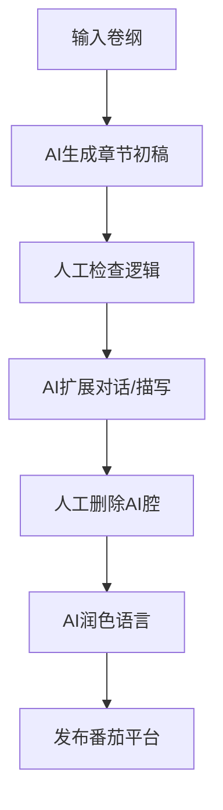

# 零基础AI辅助番茄小说100万字创作全攻略-kimi

## ✅ 模块一：创作前期准备（方向+设定）

### 1.1 小说类型选择（参考番茄热门品类）

|类型|子类|特点|适合人群|
| ------| ------------------------| --------------------| ------------|
|都市|重生、赘婿、职场、神豪|爽点密集、代入感强|新手首选|
|玄幻|修真、系统、无敌流|世界观大、升级爽|擅长设定者|
|言情|甜宠、虐恋、先婚后爱|情绪共鸣强|女性用户多|
|悬疑|刑侦、无限流、灵异|节奏紧凑、钩子强|擅长逻辑者|

> ✅ 建议：新手优先选**都市+系统+爽文**，易出爆款，AI适配度高。

---

### 1.2 核心卖点设计（金手指+爽点）

|模块|示例|AI辅助建议|
| --------| ------------------------------| -----------------------------------------------|
|金手指|投资系统、读心术、时间回溯|用AI生成“系统面板+触发条件+奖励机制”|
|爽点|打脸反派、暴富逆袭、权谋翻盘|每章设置1-2个“情绪爆点”，AI生成“爽点模板”|

---

### 1.3 世界观与人物设定（AI模板化生成）

#### ✅ 世界观模板（AI提示词示例）：

```
请为一部“都市+神豪+系统”小说设计世界观，要求：
- 时间：现代2025年
- 地点：魔都上海
- 系统设定：消费双倍返现+隐藏任务
- 社会规则：富豪等级制度（ABCD级）
- 输出格式：世界观说明书+地图+势力表
```

#### ✅ 人物设定模板（AI生成角色卡）：

```
角色类型：主角
姓名：林渊
身份：被赶出家族的废少
金手指：神豪消费系统
性格：冷静、理智、记仇
目标：夺回家族、打脸仇人
外貌：黑衣、薄唇、桃花眼
口头禅：你不配让我动手
```

---

## ✅ 模块二：AI工具选型与配置（3+2组合）

|工具|类型|优点|缺点|适用场景|
| ------| ------| ------------------------| ------------| ----------------|
|**Kimi（月之暗面）**|免费|中文强、长文本、记忆好|无插件|大纲/章节/润色|
|**Sudowrite**|付费|场景扩展强、风格多样|英文主、贵|描写/对话/情绪|
|**DeepSeek**|免费|网文模板多、角色卡强|需注册|人物/支线/反转|
|**Claude（3.5）**|付费|逻辑强、文学性高|需翻墙|悬疑/文学向|
|**Dify（自建）**|开源|可定制流程|需技术|自动化写作链|

---

## ✅ 模块三：AI辅助创作流程（可复用模板）

### 3.1 大纲生成（三阶法）

#### ✅ 总纲（AI提示词）

```
请为一部“都市神豪+打脸爽文”生成总纲，要求：
- 总字数：100万字
- 结构：10卷×10章×1万字
- 主线：主角从被逐出家族到建立商业帝国
- 输出：三幕式结构+每卷高潮+最终反转
```

#### ✅ 卷纲（每卷1万字×10章）

```
卷一：被逐出家族
- 第1章：逐出家门，激活系统
- 第2章：首次消费，打脸堂兄
- ...
- 第10章：买下家族公司，反杀仇人
```

#### ✅ 章纲（每章1000字×10节）

```
章节：第1章《逐出家门》
- 1. 雨夜被赶
- 2. 系统激活
- 3. 初获奖励
- 4. 路人嘲讽
- 5. 反手打脸
```

---

### 3.2 章节内容创作（提示词模板）

#### ✅ 章节提示词（避免同质化）

```
请根据以下信息生成一章小说内容（1000字）：
- 类型：都市神豪爽文
- 章节名：第3章《双倍返现，买下商场》
- 爽点：路人嘲讽→系统提示→反手打脸
- 风格：快节奏+对话多+情绪强烈
- 避免：重复用词、空洞描写、AI腔
- 输出：分镜式段落+情绪标注（如【爽点】【嘲讽】【反转】）
```

---

### 3.3 人工把控剧情（三阶润色法）

|阶段|人工任务|AI辅助|
| ------| --------------| ------------|
|初稿|检查逻辑漏洞|AI生成章节|
|二稿|强化情绪爆点|AI扩展对话|
|终稿|删除AI腔|AI润色语言|

---

## ✅ 模块四：番茄平台适配策略（机制+风格）

### 4.1 黄金三章模板（AI生成+人工调优）

|章节|功能|AI提示词模板|
| -------| ------------------| --------------|
|第1章|钩子+人设+金手指|`生成一章：主角被赶出家门+雨夜+系统激活+路人嘲讽+反手打脸`|
|第2章|爽点+奖励+升级|`生成：主角首次消费+双倍返现+买下商场+震惊全场`|
|第3章|悬念+敌人+伏笔|`生成：反派登场+埋下复仇线索+主角冷笑“下周你破产”`|

---

### 4.2 平台节奏机制（AI节奏表）

|指标|建议|AI辅助|
| ------------| -------------| --------------------|
|每章爽点|至少1个|AI生成“爽点库”|
|每3章悬念|1个未解之谜|AI生成“悬念钩子”|
|每10章反转|1次大反转|AI生成“反转模板”|

---

### 4.3 标题/简介/标签（AI批量生成）

#### ✅ 标题模板（番茄风格）

```
模板：【神豪+打脸+女帝】被赶出家门后，我靠消费系统成首富！
AI生成：输入“神豪+系统+打脸”，输出10个爆款标题
```

#### ✅ 简介模板

```
被赶出家门那天，雨很大，我很冷。
但没人知道，我激活了【神豪消费系统】。
从此，我花一万，返两万，买公司，买商场，买豪门！
曾经羞辱我的人，如今跪在我脚边求我收购。
而我，只说一句：
“你不配。”
```

---

## ✅ 模块五：百万字创作规划（可执行日历）

### 5.1 阶段目标拆解

|阶段|时间|字数|工具|备注|
| --------| ---------| ------| ---------------| ------------|
|准备期|第1周|0|AI+Notion|大纲+设定|
|启动期|第2-4周|10万|Kimi+DeepSeek|日更4000字|
|加速期|第2-3月|30万|自建流程|日更6000字|
|冲刺期|第4-6月|60万|AI批量+人工|日更8000字|

---

### 5.2 长期新鲜感策略

|方法|AI辅助|
| --------------| ----------------------------------|
|每卷换新地图|AI生成“新城市+新势力+新规则”|
|每卷换新反派|AI生成“反派档案+动机+弱点”|
|每卷换新技能|AI生成“系统升级+新奖励+新任务”|

---

### 5.3 避免疲劳与重复

|问题|解决方案|
| ------------| -------------------------------|
|剧情重复|AI生成“支线任务+反转事件”|
|人物脸谱化|AI生成“角色成长弧+内心冲突”|
|语言疲劳|AI轮换风格（幽默/冷峻/热血）|

---

## ✅ 模块六：风险规避与质量把控

|风险|表现|解决方案|
| ----------| ----------------| ---------------------------------|
|查重率高|AI内容雷同|人工改写+AI降重|
|内容空洞|只有爽点无情感|加入“人物动机+内心独白”|
|读者流失|中期疲软|每10章设置“情绪爆点+悬念钩子”|

---

## ✅ 附赠：AI写作流程图（可复制到Dify自建）



---

## ✅ 总结：一句话记住

>  **“AI是打字机，你是导演。别让它写故事，让它帮你拍。”**

---

如你需要，我可以为你：

- 生成一套完整的**100万字大纲模板**
- 搭建一个**Dify自动化写作流程**
- 提供**番茄小说爆款标题库（100条）**

是否需要我帮你生成**第1卷大纲+第1章正文**？
