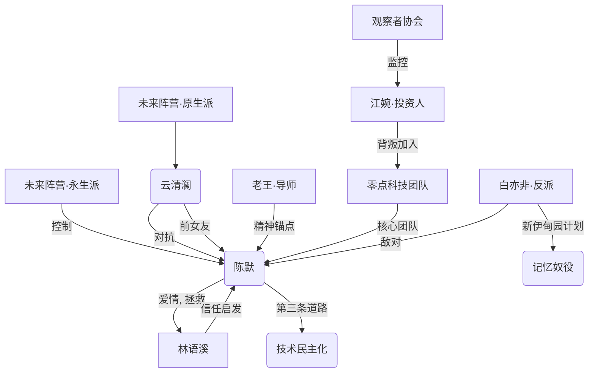

# 《电磁之神：从零开始的信息帝国》总纲

**核心哲学母题：**  "当一个人失去所有物质依凭,仅凭意识与信息便能主宰世界,他究竟是神还是囚徒?" 这是一个关于存在本质、权力异化与人性救赎的当代神话。主角将在数字与肉身、控制与自由的悖论中,探寻"我是谁"这一终极命题。

---

目录  
[toc]

---

### 一、核心设定卡

#### 【超级芯片·共生系统】

- **名称**: 量子共生脑(QBS-2157)
- **来源**: 2157年生物计算机
- **安装位置**: 脑干+全神经网络
- **能量消耗**: 神经元能量(使用=头痛)

#### 【五级权限解锁】

- **Lv1 (1-100章)** : 局域感知(50km电磁波)
- **Lv2 (101-200章)** : 全球互联(卫星网络)
- **Lv3 (201-350章)** : 意识投射(进入他人设备)
- **Lv4 (351-500章)** : 时间回溯(读取历史数据流)
- **Lv5 (501-600章)** : 信息具现(改写物理现实)

#### 【三大禁忌】

1. 不能直接读取人脑
2. 每次深度入侵=消耗3天寿命
3. 使用Lv5=永久人格损伤

#### 【时间旅行规则】

- **设定**: 单向穿越,无法返回
- **限制**: 肉体穿越,只能带芯片
- **代价**: 原时间线记忆被加密锁死
- **真相**: 所有穿越者都是"信息炸弹"
- **终极秘密**: 穿越本身就是宇宙的筛选机制

### 二、人物设定卡

#### 【主角】陈默/凌霄

- **年龄**: 35岁(生理)/168岁(真实)
- **核心创伤**: 女儿死于永生派阴谋
- **性格面具**: 冷静理性/算无遗策
- **真实人格**: 极度渴望不可控的温暖
- **成长弧光**: 神→人
- **口头禅**: "我算到了一切,除了人心"
- **未来记忆碎片**:
  - 2157年,他曾是"意识上传计划"的首席工程师。
  - 亲手将垂死的女儿上传为数字生命,却发现那只是完美的模拟——真正的她已经死了。
  - 在发现真相后的三十年里,他每天与女儿的数字幽灵对话,直到无法分辨真实与虚拟。
  - 最终接受"时间种子"任务,因为被承诺:改变历史可能让女儿从未患病。
- **性格悖论**:
  - **表面**: 冷静理性,算无遗策,以信息流的方式思考世界。
  - **深层**: 极度渴望真实的触感、温度、不可预测的人性闪光。
  - **核心创伤**: 害怕一切"完美"的东西——因为完美意味着虚假。
- **能力的诅咒**:
  - 当他用芯片连接世界时,会陷入一种"信息洪流综合症"
  - 同时感知到千万人的数据轨迹,能"看见"每个人的消费记录、通话内容、浏览历史。
  - 这让他对人性既全知又无知——知道所有行为,却无法理解行为背后的情感动机。
- **有一场戏**: 他站在地铁车厢中,芯片自动解析周围所有乘客的信息。他"知道"角落里的老人昨天搜索了"安乐死是否合法",知道少女的手机相册里藏着自残照片,知道西装男正在策划诈骗......但当一个孩子突然对他微笑时,他僵住了——这个不在数据库中的纯粹善意,让他第一次感到恐惧。
- **战力系统**
  - **智力**: SS级(133年未来知识)
  - **战斗**: C级(普通格斗)
  - **黑客**: SSS级(意念入侵)
  - **商战**: S级(信息差降维打击)
  - **致命弱点**: 对"家庭"二字毫无抵抗力

#### 【女主】林语溪

- **年龄**: 26岁
- **身份**: MIT辍学天才/轻度阿斯伯格
- **天赋**: 代码直觉(能从bug中看出人性)
- **对陈默态度**: 初期好奇→中期依赖→后期平等
- **关键技能**: 唯一能"读懂"陈默代码的人
- **身份设定**:
  - 26岁,MIT计算机系辍学,患有轻度阿斯伯格综合症
  - 对代码有超乎常人的直觉,却无法理解社交暗示
  - 父亲是投资失败自杀的程序员,母亲改嫁后断绝联系
  - 她在代码世界里寻找"确定性"——因为现实人心太难预测
- - **与陈默的化学反应**:
    - 她是唯一能从代码中"读出"陈默不属于这个时代的人:"你的算法太干净了,就像没有经历过试错。但所有伟大的代码都是从bug中长出来的。"
    - "你看世界的方式,像是在读取数据而非体验生活。你到底在逃避什么?"
- **转折点: 第235章《当确定性崩塌》** :
  - 林语溪发现陈默秘密后,她用三天时间写了一个程序——模拟如果陈默从未出现,她的人生轨迹。
  - 结果显示:她会在28岁死于过劳,留下一段无人问津的开源代码。
  - 她抱着笔记本找到陈默,眼中含泪:"数据告诉我,遇见你改变了我的死亡时间线。但我宁愿选择那个会死去的自己,因为那是我自己选择的人生。而现在......我甚至不知道,我对你的爱是真实的情感,还是被你的存在编程的结果。"
- *这个质问击中陈默的核心恐惧——当一个人能改写现实,他给予的爱还纯粹吗?*
- **成长路线**
  - **第80章**: 发现陈默异常
  - **第235章**: 正面质问身份
  - **第380章**: 共同创造"第三条路"
  - **第580章**: 拯救陈默于精神崩溃

#### 【对手】云清澜

- **年龄**: 32岁(生理)/142岁(真实)
- **身份**: 时间稽查者/陈默前女友
- **穿越目的**: 唤醒陈默真实记忆
- **战力**: S级全能(专业时空警察)
- **哲学立场**: 反永生/捍卫有限性
- **真实身份**:
  - 来自2157年"原生派"的时间稽查者。
  - 与陈默曾是恋人,在意识上传争论中分道扬镳。
  - 穿越目的不是阻止陈默,而是让他记起真相。
- **哲学立场**
  - "生命的意义在于有限性。当你可以永生,就失去了选择死亡的自由。那不是进化,是阉割。"
  - "陈默,你以为自己在拯救未来,实际上你在杀死现在。每一个你改变的2024年的人,都是对他们自由意志的谋杀。"
- **关键场景: 第378章《记忆审判》** :  
  云清澜用特殊装置强行解锁陈默的记忆封印。他终于看到完整真相:
  - 女儿凌雪的病是"永生派"人为制造,为了逼他就范
  - 上传意识的技术本质上是谋杀原体,创造复制品
  - 更残酷的是:真正的凌雪在临终前留下遗言:"爸爸,不要为了我改变世界。我想要一个你们真实活过的过去,不要一个修改过的未来。"

这个真相让陈默崩溃。他质问云清澜:"如果这一切都是谎言,那我穿越的意义是什么?我改变的那些人、建立的公司、对林语溪的感情——哪些是真的?!"  
云清澜冷静回答:"全是真的。因为你用虚假的使命,创造了真实的羁绊。这就是生命的悖论——我们都是在谎言中寻找真理的囚徒。"

【关键时间点】

- **第200章**: 首次现身
- **第378章**: 解锁陈默记忆
- **第520章**: 联手对抗永生派

#### 【反派】白亦非(第二个穿越者,反派)

- **年龄**: 28岁
- **身份**: 第二穿越者/记忆篡改者
- **能力**: 直接读写人类记忆
- **理念**: "改写记忆=改写现实"
- **结局**: 被陈默删除记忆,成为普通人
- **设定**:
  - 来自2157年的黑客天才,芯片能力是"意识入侵"——可以直接读取和篡改人的记忆
  - 穿越动机:在未来犯下数字种族灭绝罪,逃到过去重新开始
  - 哲学立场:彻底的虚无主义——"既然一切都是信息,那篡改记忆和篡改现实有什么区别?"
- **核心冲突 (第290-320章)** :  
  白亦非创建"新伊甸园"计划:用芯片给贫民窟的人植入"美好记忆"——让他们相信自己很幸福"与其改变残酷的现实,不如改变他们对现实的感知。这才是真正的慈悲。"

陈默与之对决时,白亦非质问:"你改变股市、摧毁犯罪网络,不也是在篡改现实吗?我只是更高效——直接修改大脑。我们的区别只是,你伪善地保留了他们痛苦的记忆。"

决战场景:两人在精神网络中对决,武器是信息流。陈默险胜后,没有杀死白亦非,而是做了一个选择:删除他关于未来的所有记忆,让他成为真正的2024年的普通人。白亦非最后清醒的瞬间,用尽全力留下一句话:"你也会走到这一步的......当你发现拯救所有人太难时,你会选择拯救他们的感知。记住我,陈默,我是你的未来。"

【关键时间点】  
出场:第270章  
巅峰:第315章(新伊甸园计划)  
落幕:第345章

#### 【导师】老王（城中村房东,40章后的精神导师）

年龄:60岁  
身份:退休物理教师/精神锚点  
作用:用朴素智慧点醒陈默  
代表:非理性的人性温度  
关键台词:"科学尽头是玄学,玄学尽头是人心"

- **人物设定**: 60岁的退休物理教师,妻子早逝,独自抚养智障儿子。
- 看似普通,实际上是量子力学的深度爱好者。
- **与陈默的对话 (第89章)** :  
  陈默帮他修好老式收音机后,老王突然问:"小陈,你说电磁波能承载信息,那人的思念算不算一种波?我老伴走了十年,我还是每天跟她说话。你说她能收到吗?"  
  陈默愣住。他的芯片可以解析所有电磁信号,却无法回答这个问题。  
  老王笑着说:"科学告诉我们不能,但活着的意义就是相信那些不可证明的东西啊。就像你,明明可以算尽一切,却还在这里租我的破房子,陪我这老头说话。"
- **象征意义**: 老王代表着"非理性智慧"——那些无法被数据量化,却构成人性基座的温暖。

【重要场景】  
第89章:电磁波与思念  
第456章:陈默崩溃时的救赎  
第600章:书店开业的见证人

#### 江婉 (投资人,观察者协会的明面代表)

- **人物弧光**:
- 初期: 冷酷的资本猎手,试图控制陈默的公司。
- 中期: 在调查中发现陈默的异常,逐渐被他的理想主义感染。
- 后期: 背叛协会,成为陈默的盟友,代价是失去女儿的抚养权。
- **转变契机 (第410章)** : 女儿车祸,陈默用芯片入侵医院系统救回孩子。
- **对话**: 江婉说出一句话:"我一直以为你想当神。现在我明白了——你只是想赎罪。"

### 三、人物关系图谱

【未来阵营·永生派】  
↓ 控制  
【陈默】←对抗→【云清澜】→【未来阵营·原生派】  
↓ ↑ ↓  
爱情 拯救 前女友  
↓ ↑  
【林语溪】 【观察者协会】  
↓ ↓ 监控  
信任启发 ↓  
↓ 【江婉·投资人】  
【老王·导师】 ↓ 背叛加入  
↓ ↓  
精神锚点 【零点科技团队】  
【白亦非·反派】→敌对→【陈默】  
↓ ↓  
新伊甸园计划 第三条道路  
↓ ↓  
记忆奴役 技术民主化

[https://mermaid-live.nodejs.cn/edit#pako:eNpdU9lO20AU_RVrJKQgBWRSQoMfKpWlBdrHPtXhwWpcgtokyE2kthgpIYuyQEIoYclCAClFIMCBsjgbkfotvmP7qb_QwU5NyTzNPffcM2funVlGHwIeHjHI7V8QuCUv9W7K7afIGhig8IEM3ajSbKqpkz_tor6X1Fu7ZnbCZkaDbv8jvS6rW1V8fQ-ba5Ctmnt990bbqJmclywun-JKzcR-31kF89TQ0AsRZ48heStSEyZ7qo9tSRpsatKmNPNYjuP78qBZMGmogNTA6R1LpQem1qH2C3IZA390HI3jWPXBrtQGOak2u73bGUVq8pIQ7BTOSLiQF6lpFu_vaNI5bp7Om7xpg6d0D5VWCzYkyOWtc1-xWjiiZjPEt6FtXlG9uldr-_pWUV1tPLWiHa-CVNXCcVjPKe2iImehkFDkIsgVKHUsZ6_ZPmJPt5Qn3ROpGRZfVuEkRXqbLmg3MTK7ntUZg6dF1yBXgvQBxGsiNcvqpVviRD3O43QYSkf6brVHnzUnYjwAM9HXuVhOkxLQOcLhCCSu1NOIZXGOVfc6SvOnXtknl8-tP863QPrcsDo0Z4LbdaWdVrdkKJ1rF4eQ3BSpNzbtog7dBNSuodMYfDKTszNFTuHKoR75od1JIvXWRqzjsoTreUVuwdo2oSM7WhAWPYgJCiHejny84OMeQrT8IOVGQS_v492IIVsPJ3xyk7e_QmqWOP_7QMD3r0wIhBa8iPnIff5CotCShwvyU4sc-SU-CxV4v4cXJgMhfxAxIyMuQwQxy-grCWnn8DPXuMtBj9JOx7hjlGS_IWaUHnaOOZy0kyYpgo-t2NF341h62PXcSf-3Rlb-AicbtVk](https://mermaid-live.nodejs.cn/edit#pako:eNpdU9lO20AU_RVrJKQgBWRSQoMfKpWlBdrHPtXhwWpcgtokyE2kthgpIYuyQEIoYclCAClFIMCBsjgbkfotvmP7qb_QwU5NyTzNPffcM2funVlGHwIeHjHI7V8QuCUv9W7K7afIGhig8IEM3ajSbKqpkz_tor6X1Fu7ZnbCZkaDbv8jvS6rW1V8fQ-ba5Ctmnt990bbqJmclywun-JKzcR-31kF89TQ0AsRZ48heStSEyZ7qo9tSRpsatKmNPNYjuP78qBZMGmogNTA6R1LpQem1qH2C3IZA390HI3jWPXBrtQGOak2u73bGUVq8pIQ7BTOSLiQF6lpFu_vaNI5bp7Om7xpg6d0D5VWCzYkyOWtc1-xWjiiZjPEt6FtXlG9uldr-_pWUV1tPLWiHa-CVNXCcVjPKe2iImehkFDkIsgVKHUsZ6_ZPmJPt5Qn3ROpGRZfVuEkRXqbLmg3MTK7ntUZg6dF1yBXgvQBxGsiNcvqpVviRD3O43QYSkf6brVHnzUnYjwAM9HXuVhOkxLQOcLhCCSu1NOIZXGOVfc6SvOnXtknl8-tP863QPrcsDo0Z4LbdaWdVrdkKJ1rF4eQ3BSpNzbtog7dBNSuodMYfDKTszNFTuHKoR75od1JIvXWRqzjsoTreUVuwdo2oSM7WhAWPYgJCiHejny84OMeQrT8IOVGQS_v492IIVsPJ3xyk7e_QmqWOP_7QMD3r0wIhBa8iPnIff5CotCShwvyU4sc-SU-CxV4v4cXJgMhfxAxIyMuQwQxy-grCWnn8DPXuMtBj9JOx7hjlGS_IWaUHnaOOZy0kyYpgo-t2NF341h62PXcSf-3Rlb-AicbtVk)

### 四、时间线

#### 【历史线】

- **2024年**: 故事开始
- **2027年**: 陈默公司上市
- **2035年**: 关键技术节点(历史分叉)
- **2087年**: 战争爆发(蝴蝶效应)
- **2103年**: 生态灾难(被陈默间接阻止)
- **2157年**: 永生派vs原生派决战
  - → 穿越计划启动
  - → 陈默/云清澜/白亦非等人回到2024

#### 【主线时间轴】

- **第1-50章**: 赤裸求生期 (1个月)
- **第51-150章**: 商业崛起期 (6个月)
- **第151-250章**: 身份暴露期 (3个月)
- **第251-400章**: 三方博弈期 (1年)
- **第401-550章**: 终极选择期 (半年)
- **第551-600章**: 回归凡人期 (5年跨度)

### 五、故事框架

#### 【3条主线】

##### 主线A: 身份认知线

- **起**: 赤裸穿越,从零建立身份
- **承**: 商业帝国崛起,能力逐步展现
- **转**: 云清澜揭露真相,记忆解锁
- **合**: 拒绝两派,创造第三条路

 **【关键节点】**

- **50章**: 第一次暴露破绽
- **150章**: 林语溪开始怀疑
- **250章**: 观察者协会摊牌
- **378章**: 记忆完全解锁
- **500章**: 决定背叛使命

##### 主线B: 哲学探索线

- **起**: 信息全知带来的上帝视角
- **承**: 发现"全知"≠"全能"
- **转**: 白亦非事件质疑善恶
- **合**: "成为凡人"的最终觉悟

 **【理论递进】**

- **100章**: 信息本体论(一切皆数据)
- **250章**: 自由意志困境(改变=操控?)
- **400章**: 时间伦理学(过去vs未来)
- **550章**: 存在主义回归(神→人)

##### 主线C: 感情救赎线

- **起**: 孤独133年的麻木之心
- **承**: 林语溪的温度逐渐融化
- **转**: 云清澜揭露女儿真相
- **合**: 用爱定义"真实"

 **【情感里程碑】**

- **80章**: 第一次心动(林语溪的代码评论)
- **235章**: 第一次恐惧(被看穿的恐慌)
- **380章**: 第一次信任(共享秘密)
- **520章**: 第一次脆弱(为爱放弃使命)
- **600章**: 第一次圆满(平凡的婚姻)

#### 【6条支线】

1. **支线1: 零点科技争夺战(商战线) 50-200章**
   - **冲突**: 风投/竞争对手/黑客攻击
   - **爽点**: 意念操控股市/商战降维打击
   - **转折**: 发现投资人是观察者协会
   - **结局**: 公司上市,获得话语权
2. **支线2: 白亦非的新伊甸园(反派线) 270-345章**
   - **设定**: 给穷人植入"幸福记忆"
   - **冲突**: 陈默vs白亦非的理念对决
   - **高潮**: 精神网络中的意识对决
   - **结局**: 删除白亦非记忆,成为警示
3. **支线3: 江婉的背叛与救赎(策反线) 150-450章**
   - **起**: 冷酷投资人监视陈默
   - **转**: 女儿车祸被救,立场动摇
   - **高潮**: 背叛协会,失去女儿抚养权
   - **结局**: 成为"第三条路"的核心推动者
4. **支线4: 老王父子的生命哲学(温情线) 40-600章(贯穿全文)**
   - **作用**: 提供非理性的人性锚点
   - **关键场景**:
     - 89章: 电磁波与思念的对话
     - 456章: 陈默崩溃时的陪伴
     - 600章: 书店开业的祝福
   - **象征**: 科技尽头的人性温度
5. **支线5: 第三穿越者·猎杀游戏(悬疑线) 350-480章**
   - **设定**: 未来派遣"清除者"追杀叛徒
   - **悬念**: 第三个穿越者身份成谜
   - **反转**: 竟是陈默"女儿"的数字备份
   - **结局**: 陈默面对"女儿"选择放手
   - **深度**: 探讨数字生命是否算"活着"
6. **支线6: 开放未来运动(群像线) 400-600章**
   - **设定**: 被陈默影响的普通人自发组织
   - **人物**: 被救的少年/获资助的科学家/...
   - **作用**: 证明"技术民主化"的可能性
   - **高潮**: 在时间法庭上集体为陈默作证
   - **象征**: 个体改变世界的涟漪效应

### 六、爽点系统

#### 【能力爽】(每10章1次高潮)

- **Lv1**: 意念取款/黑掉监控
- **Lv2**: 股市狙击/秒破防火墙
- **Lv3**: 全球直播挟持/卫星调度
- **Lv4**: 预判犯罪/商战读心
- **Lv5**: 信息具现(代码改变物理世界)

 **【经典场景】**

- **第15章**: 赤身站ATM前,意念吐钞
- **第67章**: 3秒黑掉竞争对手服务器
- **第178章**: 用卫星追踪人贩集团
- **第299章**: 在白亦非记忆中植入"真相"
- **第555章**: 用最后的Lv5救林语溪

#### 【智斗爽】(每20章1次博弈高潮)

**对手层级**:

- **Lv1**: 普通黑客(秒杀)
- **Lv2**: 国家安全机构(周旋)
- **Lv3**: 观察者协会(势均力敌)
- **Lv4**: 其他穿越者(生死博弈)
- **Lv5**: 未来AI(绝境反杀)

 **【经典桥段】**

- **第125章**: 三步预判破解协会追踪
- **第288章**: 用信息差让两派自相残杀
- **第413章**: 时间法庭上的逻辑反杀
- **第534章**: 在精神网络中"杀死"清除者

#### 【情感爽】(每30章1次虐后甜)

**公式**: 误会 → 虐心 → 真相 → 爆甜

 **【关键场景】**

- **第235章**: 林语溪质问后的雨中拥抱
- **第380章**: 云清澜解锁记忆后的痛哭
- **第520章**: 为林语溪放弃使命的告白
- **第580章**: 林语溪闯入法庭的演讲
- **第600章**: 书店里平凡的婚后日常

#### 【打脸爽】(每15章1次)

**套路**: 被轻视 → 展示实力 → 众人震惊

 **【经典剧情】**

- **第33章**: 黑客论坛上被嘲讽 → 3秒破解
- **第95章**: 投资会上被质疑 → 预言股市暴跌
- **第267章**: 被协会抓捕 → 反控制整个基地
- **第445章**: 被判"时间罪" → 展示改变的成果

#### 【升级爽】(每100章1次大突破)

- **第100章**: 解锁Lv2, 全球网络权限
- **第200章**: 解锁Lv3, 意识投射能力
- **第350章**: 解锁Lv4, 时间数据回溯
- **第500章**: 解锁Lv5, 信息具现化
- **第600章**: 放弃所有, 回归凡人(逆向升级)

### 七、钩子系统

#### 【章末钩子】(每章必备)

- **类型1: 悬念式**
  > "门外传来敲门声,陈默的芯片显示——来者的身份信息竟然是【不存在】"
  >
- **类型2: 反转式**
  > "'你以为我是来杀你的?'云清澜笑了,'我是来救你的。'"
  >
- **类型3: 升级式**
  > "【系统提示:检测到威胁,紧急解锁Lv3权限】"
  >
- **类型4: 虐心式**
  > "林语溪转身离开,留下一句话:'等你想清楚自己是人还是神,再来找我。'"
  >
- **类型5: 爆点式**
  > "屏幕上显示:第三个穿越者已抵达——姓名:凌雪(陈默女儿)"
  >

#### 【卷末钩子】(每100章)

- **第100章**: 云清澜出现,说出"你忘记的事,我记得"
- **第200章**: 芯片显示"真实使命文件已解锁1%"
- **第300章**: 发现未来还有第四个、第五个穿越者
- **第400章**: 观察者协会展示"陈默消失"的时间线
- **第500章**: 使用Lv5代价——记忆开始崩塌
- **第600章**: 新的穿越者出现在书店门口

#### 【伏笔钩子】(贯穿全文)

- **伏笔1**: 老王的收音机为何总能收到"异常信号"?
  - → 第589章揭晓: 他是2087年穿越回来的物理学家
- **伏笔2**: 林语溪的父亲为何自杀?
  - → 第467章揭晓: 发现了时间旅行的数学证明
- **伏笔3**: 陈默为何叫"凌霄"?
  - → 第378章揭晓: "凌驾于云霄,却忘记脚下的土地"
- **伏笔4**: 芯片为何会"死机"?
  - → 第520章揭晓: 那是女儿留下的保护程序
- **伏笔5**: 2024年的"关键节点"是什么?
  - → 第555章揭晓: 某个普通人的一次选择

### 八、节奏控制表

#### 【黄金节奏】

- **爽点密度**: 每3章1个小爽,每10章1个大爽
- **虐点密度**: 每30章1次虐心(立即反转)
- **高潮密度**: 每50章1次卷级高潮
- **反转密度**: 每20章1次认知颠覆

#### 【情绪曲线】

- **1-50章**: 快节奏爽文(建立读者粘性)
- **51-150章**: 爽+悬疑(展开世界观)
- **151-300章**: 虐+爽(情感深化)
- **301-500章**: 烧脑+爆燃(哲学深度)
- **501-600章**: 温情+震撼(升华主题)

### 九、防毒点检查表

- ✓ 主角有明确弱点(神经痛/寿命消耗)
- ✓ 金手指有代价(使用=牺牲)
- ✓ 配角智商在线(不是工具人)
- ✓ 反派有完整逻辑(非脸谱化)
- ✓ 女主独立成长(非依附花瓶)
- ✓ 感情线自然发展(非强行恋爱脑)
- ✓ 装逼有铺垫(非玛丽苏)
- ✓ 哲学不说教(融入剧情)
- ✓ 悬念有答案(不强行拖剧情)
- ✓ 结局不烂尾(开放但完整)

### 十、哲学体系的叙事化

#### 核心命题A: 信息本体论

- **理论植入 (第180章, 陈默的内心独白)** : "所有文明的意识都在向某个终点汇聚...那天林语溪亲吻我时,我的芯片实时解析出她的心跳加速......可当我试图计算'我是否爱她'时,芯片死机了。也许,真实就是那些无法被完全量化的东西。就像π,无限不循环,永远算不尽。"

#### 核心命题B: 自由意志的囚徒困境

- **戏剧化呈现 (第455章)** : 陈默发现悖论——他救下的人,可能间接害死另一个人。他连续72小时用芯片计算,试图找到"完美的干预方案",结果是:不存在。
- 林语溪找到精神崩溃的他,说出全书最重要的一句话:"陈默,你不是神,也不该是神。人类的伟大不在于不犯错,而在于承认错误后依然选择行动。你给予的不应该是完美,而是可能性。"

#### 核心命题C: 时间的伦理学

- **高潮呈现 (第520章, 观察者协会的最后审判)** : 法官质问:当牺牲确定的三亿人,可以拯救可能的五十亿人,你如何选择?
- **陈默的回答**: "我拒绝选择。因为这个问题的预设就是错的——它假定未来是可以被精确计算的,假定人命可以被量化比较。但时间不是一条可以编辑的代码。每个人的生命都是独特的宇宙,无法被加减。我只是一个有限的人,在有限的信息下,做出我认为对的选择。"

### 四、高潮设计: 存在的三重审判

#### 第一重: 技术审判 (第530-560章)

- **场景**: 数字炼狱。永生派派遣"清除者程序"试图格式化陈默的意识。
- **象征意义**: "我是谁"的终极追问。
- **领悟**: 陈默在濒临崩溃时,听到林语溪的呼唤。他突然领悟:"我是我,不是因为我记得什么,而是因为有人记得我。"

#### 第二重: 伦理审判 (第561-585章)

- **场景**: 时间法庭。协会模拟出"陈默从未穿越"和"陈默完成使命"两条时间线。
- **林语溪的辩护**: "你们的模拟有个致命缺陷——它假设人类只会被动接受未来。但陈默给了我们选择的勇气。"她展示全球"开放未来"运动。
- **象征**: 证明"技术民主化"的可能性。

#### 第三重: 存在审判 (第586-600章)

- **场景**: 宇宙的回声。陈默的意识扩散到整个电磁谱中。
- **更高维度的声音**: "你以为你在改变时间?不,你只是在完成时间给你的考试——当一个有限的意识获得神的能力,他会选择成为暴君、救世主,还是回归自己?"
- **陈默的选择**: "我选择回归。因为我终于明白——神不需要爱,只有人才需要。而我,想做一个能爱、会痛、会犯错的人。"他主动切断芯片与大脑的连接。

### 十一、尾声: 凡人之歌 (第600章)

- 五年后,陈默和林语溪经营着一家书店。他已失去所有超能力。
- **对话**: 一个年轻人问他是否相信时间旅行。陈默回答:"我不知道。但我知道,最伟大的旅行不是穿越时空,而是从神变回人。"
- **终结句**: 他看着自己平凡的手掌,轻声说:"女儿,爸爸终于明白你的话了。比起改变世界,我更想真实地活过。"林语溪握住他的手:"你已经活过了。"远处,老王收音机传来沙沙声。【全书完】

## 十二、思想深度

- **存在主义**: 在绝对自由(能力)与绝对责任(改变历史)间挣扎。
- **人类哲学**: 数字永生是进化还是异化?
- **伦理学困境**: 拯救个体vs拯救整体,当下vs未来。
- **爱的本质**: 在可以计算一切的世界里,爱的不可计算性成为最后的人性证明。

## 十三、分卷构思

### 第一卷：赤裸降临 (1-200章)

### 开篇冲击

2024年深冬,凌晨三点的深圳华强北。一个赤裸男子从虚空跌落在电子市场的天台,身无片缕,却眼神如深渊。他来自2157年——一个人类意识已全面数字化的纪元。

### 核心设定

- **脑中的"共生芯片"** : 133年后的量子生物计算机,与神经元完全融合。
- **能力**: 可感知方圆50公里内所有电磁信号(手机、监控、网络、卫星),能以思维速度入侵任何联网设备。
- **代价**: 每次深度入侵会消耗神经能量导致剧痛。

### 哲学困境

他拥有神一般的能力,却连一件衣服都偷不到而不被监控捕捉。第一个夜晚,他躲在垃圾箱后,用意念操控ATM机吐出现金时,突然意识到——在信息时代,每一个行动都会留下痕迹,绝对的权力意味着绝对的暴露。

### 身份建构 (1-50章)

他必须从零开始创造"陈默"这个身份:

- 入侵公安系统伪造档案时,发现自己必须"杀死"一个数据库中的死婴身份。
- 第一次用偷来的钱买衣服,店员善意的微笑让他僵住——他已133年未感受过不带目的的人类温度。
- 租住城中村时遇到房东大妈,对方唠叨的关心让他想起早已数字化的母亲。

### 关键转折

在黑网吧,他目睹一个少年因网贷自杀未遂。用芯片追溯发现背后是精密的诈骗帝国。他第一次动用权力——瞬间瓦解整个犯罪网络,将黑钱分给受害者。但在删除监控时,他看到少年绝望的眼神,突然质疑:拯救他人,是善意还是上帝视角的傲慢?

### 商业帝国启动 (51-120章)

- 他决定建立合法的财富体系:用信息差在股市精准操作(能提前0.3秒知晓所有交易数据)。
- 创办"零点科技"公司,推出"看似普通"实则领先五年的AI算法。
- 招募第一个团队成员:天才程序员林语溪——一个看穿他不正常却选择追随的女孩。

### 感情线埋伏

林语溪某夜加班时问:"陈总,你的代码为什么从不出bug?就像...你能看到程序的灵魂。" 她的敏锐让他第一次感到恐惧——不是被揭穿的恐惧,而是害怕有人真正看见那个孤独了133年的灵魂。

### 阴谋浮现

公司融资时,他发现某风投机构背后是"观察者协会"——一个追踪时空异常的秘密组织。对方似乎知道他的来历,却在等待某个时机。

### 权力的代价 (121-200章)

随着财富积累,他开始暗中干预社会:

- 操控舆论揭露贪腐官员。
- 暗助失学儿童(通过匿名转账)。
- 在暗网猎杀人口贩卖组织。

但每一次"正义"都在改变历史轨迹。某天他发现,自己救下的一个女孩,在原本的时间线中会成为解决粮食危机的科学家,但因被救改变人生轨迹后,她成了平庸的会计。

### 哲学高潮

深夜独自站在摩天大楼顶端,他用芯片同时连接全城千万设备,感受着信息洪流在意识中奔涌。那一刻他问自己:当我可以改写任何人的命运,我究竟是在创造更好的世界,还是在扮演另一个暴君?

### 第二卷：信息囚笼 (201-400章)

### 敌人现身

"观察者协会"的特使找上门——云清澜,一个同样来自未来但属于对立阵营的时空稽查者。她告诉陈默残酷真相:他不是意外穿越,而是未来某个势力的"信息炸弹",目的是通过改变2024年的关键节点,重构整个人类文明走向。

### 身份危机

陈默发现自己的记忆可能被篡改。芯片中隐藏着加密协议,每当他试图回忆具体的未来事件,就会遭遇神经灼烧般的痛苦。

### 三方博弈

故事进入多线叙事:

1. **陈默**: 试图解锁芯片真相,同时保护正在崛起的商业帝国。
2. **观察者协会**: 布下陷阱,想抓捕他进行"时间线修正"。
3. **未知势力**: 开始在全球激活其他"穿越者",每个人都有不同的超能芯片。

### 爱情深化

林语溪在一次意外中发现陈默的秘密。她没有逃跑,而是问了一个问题:"如果你的存在本身就是错误,那我对你的感情算什么?" 这句话击碎了陈默的自我认知——他第一次意识到,自己不再是孤独的信息体,而是被爱捆绑的血肉之躯。

### 阴谋真相

在与多个穿越者的交锋中,陈默拼凑出完整图景:

- **2157年,人类分裂为两派**:
- **永生派**: 主张意识全面数字化,抛弃肉身。
- **原生派**: 坚持保留生物本质。
- 他所在的阵营(永生派)发现人类在2024-2035年间做出的某个选择,导致未来走向数字极权。于是派遣"信息种子"回到过去,试图引导人类选择另一条路——但这意味着抹除原有时间线的数十亿生命。

### 终极拷问

陈默必须选择:拯救未来(意味着当前时代的林语溪等人会因时间线重构而消失),还是背叛使命(让未来走向他曾目睹的反乌托邦地狱)?

### 第三卷：存在的意义 (401-600章)

### 反叛

陈默做出惊人决定:既不服从未来的指令,也不听从观察者协会的安排,而是建立**第三条道路**。

- 他开始构建全新的技术体系:开发"意识防火墙",保护人类免受极端数字化侵蚀。
- 推动"有机智能"理论,让AI与人类共生而非替代。
- 暗中培养新一代领袖,教导他们警惕技术乌托邦的陷阱。

### 人物升华

林语溪从跟随者成长为共同创造者。她提出"存在即联结"理论——真正的生命意义不在于永生或自由,而在于在有限时间内与他人建立的真实羁绊。

### 终局之战

未来的永生派和观察者协会同时对陈默展开绞杀:

- 全球互联网被植入"时间病毒",试图抹除他的数字痕迹。
- 现实中的暗杀、陷害、舆论围剿接踵而至。
- 最致命的是,他的芯片开始倒计时自毁——这是预设的"任务失败"惩罚。

### 最终抉择

在生命最后时刻,陈默将芯片中的所有技术知识制作成"时间胶囊",分散隐藏在全球网络的无数节点中。他给人类留下一份"使用说明书":这些技术足以让你们在50年内达到我的时代,但每一项突破都附带伦理困境。**选择权在你们手中**。

### 结局意象

陈默最后时刻解除了芯片的自毁程序,代价是**失去所有超能力,成为普通人**。他抱着林语溪,看着窗外的城市灯火说:"我曾以为,掌控信息就能理解一切。但直到失去这能力,我才明白——人类最伟大的地方,不是能够知道所有答案,而是在一无所知时,依然选择去爱,去相信,去创造。"

### 开放式终章

五年后,世界悄然改变。某些陈默埋下的技术被发现,某些被封存。人类站在新的十字路口。而失去神力的陈默,正和林语溪在小镇开了家书店,教导孩子们:"真正的智慧,不是连接所有设备,而是连接彼此的心。"但在最后一页,他的眼睛突然闪过一丝异样的光——**新的穿越者,降临了**。
