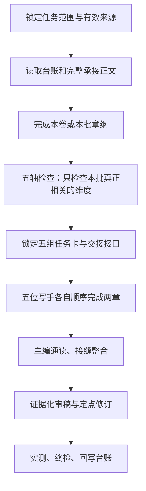

# 《我真不是霸主文明》恢复写作工作流重构草案 v0.1

> 状态：工作草案，供作者审阅；尚未替换 `AGENTS.md` 或《项目系统指令 v5.0》。
> 日期：2026-11-08
> 当前任务：整理工作流；本草案不启动第126章或其他新章节。

## 1. 当前基线

- 写作台账登记第1—125章已交付；第121—125章批次审稿闭环。下一批为第四卷第126章起，但台账标为待作者下达。
- 第125章的有效正文已通读。主人公还没有启程；他已把可公开的伪令样本交给莉莉娅，请她比对转播路径和旧格式，后续路线等待这项比对。
- 当前真实项目入口仍由根目录 `AGENTS.md`、`写作进度台账.md`、项目系统指令和实际有效正文决定。`待整理/` 内的旧方案和新下载技能是研究材料，不自动成为本项目规则。

## 2. 资料关系与采用边界

| 资料 | 已确认关系 | 可参考的做法 | 不直接继承的内容 |
| --- | --- | --- | --- |
| 五层并行写作系统 | 五层是并行观察叙事的五个账本／视角：情感、伏笔、预期、设定、意义；不是五个写手 | 重要章纲设计时用作五个可选检查镜头；只登记确实发生变化的层 | 五套常驻新台账、每章强制填满五层、虚构量化评分 |
| 《符号之海》工作流 | 按作者更正，工作流脱胎于五层并行系统 | 其 v2.1 对不可验证的 KL、胜率、检测风险等“模型自评数字”作了删除；可保留这类纠偏原则 | 不把《符号之海》当作《红星锚定》的前身；不把设定或美学移植到本书 |
| 《红星锚定》 | 独立项目、独立流程节点，与《符号之海》没有衍生关系 | 输入卡、候选路径剪枝、单要素修订、文本证据闸门、短状态交接 | 不照搬其六节拍、军政题材规则、单章新对话、额外导航文件 |
| `fanqie-novel-skill` | 外部番茄长篇技能包 | 检查状态连续性、伏笔、时间线、重复模式；从现有正文中找具体风险 | 2000—2500字、对话比例上限、BOSS必须战斗等作者自设阈值；没有出处的平台政策或数据；其建议的重复状态文件 |
| `fanqie-webnovel-prose` | 外部中文网文正文技能 | 场景的“行动—阻力—新信息—选择—局面变化”；先修连续性和因果，再修表达 | 只读上一章末尾800—1500字的简化规则；任何与本项目资料优先级、完整承接和五拍章纲冲突的要求 |

**术语分开使用：**“五层／五轴”指叙事观察维度；“五人并行”指本项目批次写作中的五位写手。两者不是一套机制，也不互相代称。

**历史文件状态：**`《符号之海》/⚛️4-场景卡片用文档/4-五层并行文档.md` 当前只有4字节，不能作为可读规则源。可读的五层定义在 `本人历史小说资料/04.3-五层并行写作系统/五层并行写作系统v1.0.md` 与 `v2.0.md`。

## 3. 新工作流结构

采用两个相套的循环：外圈管理授权范围、资料版本、十章协作与交付；内圈管理一章的构思、落笔、修订与状态变化。项目规则仍由本书文件控制，技能只提供可选检查方法。

### 阶段0：确认任务与范围

**输入：**作者当轮指令、台账第一节。  
**执行：**区分本轮是讨论、审稿、修订、指定章节、十章批次或完整卷。不得把“准备恢复写作”自动视为开始写第126章。  
**输出：**本轮目标、明确范围、当前阻断点。  
**通过条件：**作者授权范围清晰；未被授权的章节不进入写作。

### 阶段1：锁定真实状态与资料版本

**执行顺序：**

1. 读台账第一节。
2. 打开台账所指的上一章有效正文并完整读取；需要时再读相关前章。
3. 核对章纲、清单、分卷大纲、设定、节拍库的实际文件版本及台账状态。
4. `待整理/` 和下载技能只作为候选方法来源，不能覆盖已确认事实。

**输出：**入口状态、人物知情、时间地点、关键物件、未兑现事件、资料版本及冲突清单。  
**通过条件：**台账、文件和规则版本无未处理的关键矛盾。

### 阶段2：先完成当前范围的章纲

- 完整卷任务先完成该卷全部章纲；单个十章批次至少锁定十章详细章纲和批次外接口。
- 继续使用本书当前有效的**五拍章纲**。复杂章节可先发散两三条事件路径，再选定主线与副线；简单章节不强制跑 ToT，也不为形式制造分支。
- 章纲必须锁定起因、冲突、结果、人物知情、物件和时间地点、揭密边界、章末具体节点及下一章接口。
- 五轴检查嵌在章纲中，每项只回答与该章有关的问题：
  - 情感：关系或情绪状态发生什么变化？
  - 伏笔：埋入、推进、回收或暂不触碰什么？
  - 预期：读者此刻合理期待什么，结果如何兑现或改写？
  - 设定：哪条规则被展示或测试，哪些边界仍要守住？
  - 意义：已有物件、意象或主题在本章是否发生变奏？
- 若某一轴没有实质变化，标“本章不触发”，不新增材料、不强行制造意义。

**输出：**可执行的章纲、批次目标、五组写手接口。  
**通过条件：**无缺章、错序、因果断点或组间无法执行的状态交接。

### 阶段3：锁定任务卡并并行起草

- 十章按章号分成五组，每组两章；同一组内先写完前一章并核验，再写后一章。
- 每张任务卡列出：允许修改文件、两章顺序、有效前文、章纲与清单、入口状态、必须事件、不可改变的结果、人物知情、物件／时间／地点、出口状态及验收标准。
- 写手只写获派的正文文件；正文不混入状态、审稿、字数或修订说明。
- 按本项目指令核验指定执行位、模型与推理强度。指定执行条件不可用时，停在派发前说明限制，不伪称并行已发生。
- 正文层可参考 `fanqie-webnovel-prose` 的动作—阻力—信息—选择—状态变化循环；不得让外部技能改变本书章纲、揭密时点、人物权限或文件规则。

**通过条件：**五组分工无重叠、无遗漏；每章仍以有效五拍章纲为唯一写作合同。

### 阶段4：主编整合与读者侧检查

主编逐章完整读取十章正文，并逐对检查九个接缝和批次首尾。按以下顺序修：

1. 事实、人物知情、权限、因果、时间地点、物件状态。
2. 章纲关键结果、伏笔边界、读者承诺和实际兑现。
3. 章节推进是否带来新选择、关系或后果；是否重复同一误读循环。
4. 读者能否看清角色目标、阻力、行动和代价；章末是否落到已发生的具体节点。
5. 句子、对白、段落节奏和项目文风。

发现问题先标确切章节和原文，再给影响、改法与处置状态。不能用“商业性不足”“AI味重”等抽象判词替代文本证据；不能虚构读者反馈或平台数据。

### 阶段5：单点修订与证据闸门

- 按问题根因修复。语言症状来自结构问题时，回到事件或场景修；不要先做同义词替换。
- 一次局部迭代优先只处理一个根因维度：事件推进、连续性、身体／环境反馈、旁人反应、流程卡点或句子口感。
- 审稿按本项目要求分为必改、优先改、可选改、待作者裁决。修复必改和优先改；剧情重构、核心设定或既成事实不自行裁决。
- 放行依据必须是正文证据。每项检查写明位置、证据、问题、影响和具体修复；允许不通过。

### 阶段6：机器可核验项目与最终复读

- 使用只读脚本按本项目 `[一-鿿]` 口径实测每章汉字数；禁止使用会改写正文标点的脚本做计数。
- 扫描作者目录用语、半角标点和本项目明确禁用表达；对命中项按语境判断，不把词频当结论。
- 重新核对人物知情、物件位置、时间地点、清单起因／冲突／结果、章末节点、所有九处接缝及审稿修订影响。
- 结构统计、重复模式检测只能报警，不能自动改写剧情；不采用无可靠输入的相似度百分比或“过线分”。

**通过条件：**十章均在本项目字数范围内；全部必改项清零；优先改项逐项处置；证据、正文和有效版本相符。

### 阶段7：只回写本书现有台账

依台账文首规则更新第一节、第二节、必要时第三节和第四节。继续以台账作唯一有效进度入口；不另建与它竞争的 `current_state.md`、`pending_hooks.md`、`handoff_current.md`。交付状态清楚区分：初稿、整合稿、审稿待修、批次完成、作者确认和发布。

## 4. 触发条件与不做事项

| 情况 | 处理 |
| --- | --- |
| 五轴有一轴与本章无关 | 不填、不建账、不为完整表格硬造内容 |
| 事件路线不确定且影响因果或人物选择 | 提供有限候选路线，标出代价与影响，按作者裁决锁定 |
| 章纲清楚、事件简单 | 直接按有效五拍章纲写，不强制 ToT |
| 外部技能和本书规则冲突 | 本书 `AGENTS.md`、作者裁决、有效章纲优先；技能只作检查清单 |
| 平台数据、签约门槛、流量或 AI 处罚说法 | 只采用有来源的当前官方资料；未核验就不写成事实或本书门槛 |
| 核心设定或既成事实缺失、冲突 | 登记阻断点；不靠猜测补全 |
| 字数、质量或模型自报数据 | 只记录实际脚本、文件和人工审稿能够验证的结果 |

## 5. 当前发现的正式化前检查项

1. `AGENTS.md` 目前将五拍节拍库 v2.2 列为当前资料版本；该 v2.2 文件实际存在。
2. 根目录《项目系统指令 v5.0》的旧资料表仍写 v2.0。依 `AGENTS.md` 优先级，执行时使用 v2.2；正式发布新流程前，应由主编更新或替换这处旧引用，不能让两份有效入口继续冲突。
3. 本草案尚未决定是作为 v5.0 的兼容补充，还是审核后替换为新主版本。审核前不改 `AGENTS.md`、v5.0、台账、章纲或正文。

## 6. 本草案验收标准

- 《符号之海》的五层来源与《红星锚定》的独立关系标注正确。
- 清楚区分五轴观察与五人并行写手。
- 两个外部技能仅吸收经本书规则筛选的操作方法；不引入未证实平台政策、错误字数口径或重复状态账本。
- 每个阶段有输入、动作、产物和放行条件。
- 不启动第126章，不改变现行有效版本。
